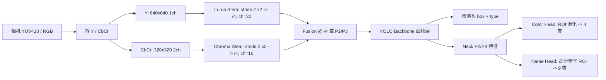

# 双流特征解耦调研：让「灯条颜色」与「装甲板图案」同时被学到

> 调研日期：2026-10-23 · 场景：RoboMaster 装甲板识别（队伍颜色 × 兵种图案）
> 结论状态：方向成立，但不能只靠「拆两路」；需要「分辨率分配 + 属性解耦 + 反捷径增强」三件套同时做。

---

## 0. TL;DR

1. **主人的直觉方向是对的，但双流本身不是解药。** 单流 CNN 学不到两个特征，本质是三类冲突叠加：
   - **频率/分辨率错配**：颜色是低频、全局、强对比信号；图案是高频、局部、弱对比信号。同一张 `320×320` 输入里，灯条还能剩十几个像素，图案只剩 4–7 px。
   - **捷径学习（shortcut）**：颜色特征与标签的互信息远高于图案，交叉熵会优先拟合颜色，图案的梯度被淹没——这不是「容量不够」，是「优化器不想学」。
   - **任务耦合**：把「队伍+兵种」做成一个组合 softmax，颜色和图案在同一个分类头里争夺特征，天然互相干扰。
2. **文献上「亮度全分辨率 + 色度低分辨率」的双流/非对称结构有成熟先例**（YUV 4:2:0、RGB-IR 双流、Octave Convolution、Octave-YOLO、Chroma-YOLO），工程上可行；但公开工作里没有直接针对「装甲板灯条/图案」的现成方案，需要自己拼。
3. **推荐路线（按投入排序）**：
   - 先做 **L0 属性解耦头**（改标签+多头，1–2 天）——不动结构就能验证「是不是任务耦合」；
   - 再做 **L2 非对称双流**（Y 全分辨率 + CbCr 半分辨率，mid-fusion，1–2 周）——对应主人的原始想法；
   - 以 **L3 两阶段 ROI 图案分类**（检测框 + 高分辨率灰度裁切，1 周）作为上限参考和兜底；
   - 全程配 **4:2:0 一致性训练 + 反事实颜色交换**，否则双流也会继续走捷径。

---

## 1. 问题拆解：为什么「灯条特征」和「图案特征」不能同时学到

### 1.1 本地现状证据

**现有部署链路（sp_vision_25）已经是「检测 + 属性头」结构：**

- `sp_vision_25/tasks/auto_aim/yolos/yolov5.cpp:119` 从 YOLOv5 输出行里取 `colRange(9, 13)` 作为 **4 类颜色**（red/blue/extinguish/purple），`yolov5.cpp:120` 取 `colRange(13, 22)` 作为 **9 类图案名**（one…five/sentry/outpost/base/not_armor）。也就是说颜色和图案是两个独立的 one-hot 头，但**共享同一个 P3 特征图**。
- `sp_vision_25/tasks/auto_aim/classifier.cpp:25-27`：另一条链路把 `armor.pattern` 转灰度、缩放成 `32×32` 送 tiny_resnet 分类——**图案只用灰度**，颜色完全不参与。
- `sp_vision_25/tasks/auto_aim/armor.hpp:18`：颜色枚举就是 4 类；`armor.hpp:27-38`：图案名 9 类。

**训练侧（ctts）：**

- `ctts/tools/yolo_train.py:37`：`"imgsz": 320`。
- 当前 `ctts/dataset/sLabelData/data.yaml` 只有 1 类 `stb`，不是「兵种+队伍」数据集——下面的像素估算按你们 RM 场景的 720×540 抽帧样本做参考。

**像素尺度实测（`DataSet_1011` 抽帧，45 帧统计）：**

| 量 | 原图（720×540） | @ imgsz 320 | @ imgsz 640 |
|---|---|---|---|
| 灯条中位数 | 9.5 × 49.5 px | 4.2 × 22 px | 8.4 × 44 px |
| 装甲板宽度（约 2.5–3× 灯条宽） | ~25–30 px | ~11–13 px | ~22–27 px |
| 中间图案区域（约装甲板宽 50–60%） | ~14–18 px | **~6–8 px** | ~12–16 px |

> 结论：在 320 输入下，图案已经接近「不可辨认」。**任何结构都救不了一个只剩 6 px 的图案。** 这是先于网络结构的硬约束。

注意一个容易忽略的域差：部署相机是 1920×1080（`sp_vision_25/configs/example.yaml:23-24`），ROI 600×600（`example.yaml:16-21`），图案在 ROI 里约 40 px；而训练/验证用的 `DataSet_1011` 是 720×540 抽帧，图案只有 15 px 左右。**训练域分辨率低于部署域**，会系统性低估模型上限，也会让「分辨率不够」这个问题在离线评估里显得更严重。

### 1.2 四个机制（按重要性排序）

**(a) 频率-分辨率错配（最硬）**

- 颜色：低频。灯条是纯色发光条，几十个像素的颜色均值就足够区分红/蓝/紫/灭。
- 图案：高频。数字的笔画、缺口、字符间差异都在 1–3 px 的尺度上。
- 同一个 `H×W` 输入、同一个 stride 的 backbone，对这两类信号的「最优采样率」不同。把两者塞进同一张低分辨率图，等于用看颜色的分辨率去看图案。

**(b) 捷径学习 / 梯度支配**

- 颜色特征与「队伍」标签几乎完全相关，且提取成本低（浅层 1×1 卷积就能做到）；图案需要多层纹理组合。
- 交叉熵训练会先降低容易的误差，颜色头快速收敛后，共享特征里的图案梯度占比越来越小。表现就是：**颜色 acc 很高、图案 acc 卡住**，或者反过来（做了强颜色增强后颜色崩、图案也上不去）。
- 这是文献里典型的 shortcut learning / texture bias 现象，不是你们的数据不够。

**(c) 任务耦合 / 负迁移**

- 组合类别（如「红1」「蓝2」）让颜色和图案在同一个 softmax 里竞争：类别间的决策边界同时被颜色和图案拉动。
- 组合类别还会放大长尾：红/蓝/紫 × 9 图案 = 20+ 类，某些组合样本极少，图案头的有效监督被进一步稀释。
- 这也解释了为什么「总是不能同时」：联合准确率被两个子任务里较差的那个拖住，且训练时两个头的梯度方向可能冲突。

**(d) 数据与增强**

- `ctts/tools/yolo_train.py` 里 `hsv_s: 0.7`、`hsv_h: 0.015`：强饱和度抖动会把颜色信号打散，颜色头和图案头都受影响；而颜色恰恰是「队伍」的唯一可靠线索。
- 720×540 视频多为 MJPEG/H.264，色度已经 4:2:0 子采样 + 有损压缩，红蓝灯条边缘的色度被抹平；如果训练数据来自这种视频，色度质量本身就不高。

### 1.3 术语澄清：「码率」对 CNN 意味着什么

主人说的「高码率/低码率」，在视频编码里指比特率，但对 CNN 而言真正起作用的不是比特率，而是 **空间分辨率 × 通道数 × 每像素的有效信息量**。所以这句话可以精确翻译成：

> **亮度通道用全分辨率（高空间带宽），色度通道用半分辨率（低空间带宽），两路分别提特征再融合。**

好消息是：**相机/USB 输出天然就是这种结构**。YUV 4:2:0 里 Y 是全分辨率、CbCr 各 1/4 像素数；4:2:2 是 1/2。如果相机直出 YUYV/NV12，你们不需要额外「拆流」，只需要在 GPU 上把 Y 和 UV 分开喂给两个分支即可。训练时也必须用同样的 4:2:0 变换模拟，否则训练（RGB 全色度）和部署（YUV420）之间存在域差。

另外要区分两种情况：

- **真·视频码流拆分**（H.264 的 Y/C 分量、MIPI 的 RAW/YUV）：工程上可行，但收益主要在带宽，不在识别精度；
- **网络输入端的双分辨率**：这才是对识别精度有直接影响的层面，也是本报告讨论的重点。

---

## 2. 文献地图

> 说明：以下为公开资料检索结果（free-search，exa/tavily/keenable 引擎），部分页面只拿到摘要级信息，结论以「该工作提出/采用」表述，未逐篇复现实验。

### 2.1 多模态 / 双流目标检测

- **RGB-IR 双流检测**是这个思路最成熟的近亲：可见光提供纹理/颜色，红外提供热辐射/轮廓，两路 backbone 分别提特征后融合。
  - `Removal and Selection: Improving RGB-Infrared Object Detection via Coarse-to-Fine Fusion`（arXiv:2401.10731）指出「直接把 RGB 特征注入融合」会引入冗余/噪声，提出由粗到细的融合与选择。
  - `FQDNet`（Remote Sens. 2025）用四头网络做 RGB-IR 融合。
  - `ADNet`（MMAsia 2023）明确提出 **asymmetric dual-stream**：两路 backbone 不对称，按模态质量分配容量。
  - `AsymFusionNet`（Symmetry 2025）做空域-频域的非对称融合。
  - `IC-Fusion`（arXiv:2505.15137）以红外为中心做 sensor fusion。
- **对本案的启示**：
  - 「不对称」是被验证过的：不需要两路同容量，弱模态给轻量分支即可；
  - 融合位置很关键：early fusion 容易把两路信号又混回一起，mid/late fusion + 门控更稳；
  - RGB-IR 的经验是「融合前先各自提纯」，对应到本案就是「色度支路只保留颜色、亮度支路只保留结构」。

### 2.2 频率 / 分辨率分层

- **Octave Convolution**（ICCV 2019，`Drop an Octave`）：把特征图按频率拆成高频/低频两组，低频用低分辨率卷积，减少空间冗余。**这是「按频率分配分辨率」最直接的理论先例**，和主人的想法同构（只是它作用在特征层而非输入层）。
- **Octave-YOLO**（arXiv:2407.19746）：把 octave 卷积用于检测，跨频率提特征。
- **P2 高分辨率检测头**：大量小目标检测工作（SOD-YOLO、SMA-YOLO、CPDD-YOLOv8 等）证明增加 `P2`（stride 4）检测层能显著改善小目标。对本案，P2 是「让图案在特征图上多活几层」的最低成本手段。
- **两阶段 / ROI 放大**：车牌识别（PatrolVision 等）的标准做法是「先检测车牌，再裁切放大做字符识别」，和 RM 的「先检测装甲板，再裁切图案分类」完全同构。

### 2.3 色彩空间与色度

- **YUVMultiNet**（arXiv:1904.05673）：直接在 YUV 输入上做多任务 CNN，说明网络第一层适配 YUV 是工程可行的。
- **Chroma-YOLO**（2025，PMC12654244）：在 YCbCr 空间利用色度通道做缺陷检测，属于「显式建模色度」的检测工作。
- **压缩/色度对检测的影响**：`First Gradually, Then Suddenly`（Sensors 2022）系统评估了有损压缩对检测的影响；`Understanding How Video Quality Affects Object Detection Algorithms` 报告中等压缩下检测性能显著下降。**这提醒你们：训练数据的压缩质量会直接封顶图案识别。**
- **灰度↔RGB 域差**：`A Kernel-Aware Regularization Model for Chromatic-Robust Detection`（J. Imaging 2026）分析灰度训练、RGB 部署的分布漂移——正是「灰度支路 + 彩色支路」混合训练会遇到的坑。
- **颜色空间选择的 XAI 分析**（IMSA 2025）表明颜色空间选择对检测有可测量的影响，不是无关紧要的预处理。

### 2.4 解耦与捷径

- **颜色-形状显式解耦**：`Disentanglement of Color and Shape Representations for Continual Learning`（arXiv:2007.06356）通过改网络结构显式分离颜色与形状表征，验证了解耦特征更稳。
- **Texture bias**：`Mitigating Shortcut Learning: Texture-Penalized Prototype Networks`（2026）指出 CNN 有强纹理偏置，会优先局部高频而非全局形状——这正好解释「图案（高频）反而学不过颜色（低频）」的反直觉现象：**颜色在低分辨率下仍是强信号，图案在高频被降采样后变成噪声**。
- **任务冲突**：`Recon: Reducing Conflicting Gradients from the Root for Multi-Task Learning`（arXiv:2302.11289）、`Task-Specific Context Decoupling for Object Detection`（arXiv:2303.01047）说明分类/定位、不同属性头之间的梯度冲突是真实存在的，需要结构或优化层面的解耦。
- **多任务属性识别**：MPAR-RCNN 等「检测 + 属性」框架证明「一个检测框 + 多个属性头」是成熟范式，比组合类别更抗长尾。

### 2.5 RoboMaster 工程先例

- **GKD 2023**（`HaoqinHong/GKD-RoboMaster-Five-Point-Dataset`、`RoboMasterUnionGKD2023`）：YOLOv5-face 五点检测 + 分类，公开了五点数据集。
- **K-Vision**：端到端关键点检测框架，覆盖 ROS2 数据提取到 TensorRT 部署。
- **FYT2024_vision**（`CSU-FYT-Vision/FYT2024_vision`，`number_classifier.cpp`）：经典「灯条几何 + 数字分类器」两阶段。
- **qianli_vision**（DeepWiki 有拆解）：传统灯条检测 + ONNX 数字分类。
- **交龙教程**（sjtu-robomaster-team）：YOLO 装甲板四点预测的入门实践。

> 共同点：**RM 社区的主流做法本来就把「颜色/几何」交给传统视觉或检测头，把「图案」交给独立的灰度分类器**。你们想用单阶段模型一步到位，才会正面撞上这个耦合问题。

---

## 3. 方案设计

### 3.1 总览矩阵

| 代号 | 方案 | 改动量 | 预期收益 | 主要风险 |
|---|---|---|---|---|
| L0 | 组合类别 → 多标签属性头（颜色头 + 图案头） | 1–2 天 | 消除任务耦合，定位问题 | 特征仍共享，分辨率不够时图案仍差 |
| L1 | 4 通道输入（RGB + Y）或 YUV 6 通道 | 2–3 天 | 显式给亮度独立通道，保留预训练权重 | 同分辨率，不解决图案太小 |
| L2 | **非对称双流：Y 全分辨率 + CbCr 半分辨率，mid-fusion** | 1–2 周 | 同时满足「颜色低频」「图案高频」 | 需改 dataloader/模型/导出，融合不当仍走捷径 |
| L3 | 两阶段：检测框 + 高分辨率灰度 ROI 图案分类 | 1 周 | 图案分辨率最高，最稳 | 多一次前向，延迟/工程复杂度增加 |
| L4 | 反事实颜色交换 + 4:2:0 一致性训练 | 2–3 天 | 切断颜色捷径，提升跨场地泛化 | 增强过强会伤颜色头 |

推荐组合：**L0 → L2 →（并行做 L3 作为上限参考）→ L4 贯穿**。如果时间紧，L0 + L3 的性价比最高；如果坚持单网络端到端，L0 + L2 + L4。

### 3.2 L0：属性解耦头（先做，成本最低）

把标签从「组合类别」拆成三个独立属性：

- `armor_type`：大/小（几何，检测头顺带学）；
- `color`：红/蓝/紫/灭（4 类，来自色度）；
- `name`：1–5/哨兵/前哨/基地（9 类，来自灰度图案）。

YOLO 头输出改为 `[box(4), obj(1), color_logits(4), name_logits(9)]`，两个属性各自 softmax，损失加权：

```python
loss = loss_box + loss_obj + 1.0 * loss_color + 2.0 * loss_name
```

`loss_name` 建议用 focal loss 或 class-balanced CE（图案类长尾）；`loss_color` 用 label smoothing 0.05。

这一步能直接回答一个关键问题：**在不动结构的前提下，解耦头能不能让图案 acc 涨起来？** 如果涨不动，说明瓶颈在分辨率/特征，不在任务耦合，再上双流才有意义。

### 3.3 L1：四通道 / 六通道输入（过渡方案）

- 最省事：输入 4 通道 `(R, G, B, Y)`，其中 `Y = 0.299R + 0.587G + 0.114B`。第一层卷积 `3→16` 改成 `4→16`，新增通道权重初始化为 0 或复制 Y 的近似组合，其余加载预训练权重。
- 更彻底：输入 6 通道 `(Y, Cb, Cr, Y_hi, Cb_hi, Cr_hi)`，其中 `Y_hi` 是高分辨率亮度、`Cb_hi/Cr_hi` 是上采样色度——但这等价于单流，不省算力，只作为消融对照。
- 特点：**保留预训练、改动小、能快速验证「显式给亮度通道」有没有用**；但它不解决「图案分辨率不足」，不要期待太高。

### 3.4 L2：非对称双流（核心方案）

#### 3.4.1 数据流与结构



要点：

- **亮度分支全分辨率、单通道**：承载灯条几何、装甲板轮廓、图案纹理；
- **色度分支半分辨率、双通道**：只承载红/蓝/紫色度，**故意低分辨率**，让它无法编码图案；
- **融合放在 /4（P2 前）或 P2/P3**：太早（stem 内）会把两路又混成一路；太晚（各自独立检测头）会浪费共享定位信息；
- **两个属性头分开取特征**：颜色头从色度分支/低分辨率特征取，图案头从高分辨率亮度特征取。这是与 L0 的本质区别——L0 只是「头分开」，L2 是「特征来源也分开」。

#### 3.4.2 参考实现（PyTorch，示意）

```python
import torch, torch.nn as nn, torch.nn.functional as F

class Conv(nn.Module):  # 简化版 ultralytics Conv
    def __init__(self, c1, c2, k=3, s=1):
        super().__init__()
        self.conv = nn.Conv2d(c1, c2, k, s, k // 2, bias=False)
        self.bn = nn.BatchNorm2d(c2)
        self.act = nn.SiLU()
    def forward(self, x):
        return self.act(self.bn(self.conv(x)))

class AsymDualStem(nn.Module):
    """Y: B,1,640,640 ; UV: B,2,320,320 -> 融合后 B,32,160,160 (stride 4)"""
    def __init__(self, c_out=32):
        super().__init__()
        self.luma = nn.Sequential(
            Conv(1, 16, 3, 2),      # /2
            Conv(16, c_out, 3, 2),  # /4
        )
        self.chroma = nn.Sequential(
            Conv(2, 8, 3, 2),            # /2 -> 相对原图 /4
            Conv(8, c_out // 2, 3, 2),   # /4
        )
        self.fuse = Conv(c_out + c_out // 2, c_out, 1)

    def forward(self, y, uv):
        fy = self.luma(y)                              # B,32,H/4,W/4
        fc = self.chroma(uv)                           # B,16,H/4,W/4
        return self.fuse(torch.cat([fy, fc], dim=1))

class GateFuse(nn.Module):
    """门控融合：色度特征只在需要处注入，避免把图案细节冲淡"""
    def __init__(self, c):
        super().__init__()
        self.gate = nn.Sequential(nn.Conv2d(c, c, 1), nn.Sigmoid())
    def forward(self, f_l, f_c):
        f_c = F.interpolate(f_c, size=f_l.shape[-2:], mode="bilinear", align_corners=False)
        return f_l + self.gate(f_c) * f_c
```

- 接入 ultralytics：把 `yolo26n.yaml` 的 backbone 首两个 stride-2 Conv 替换为 `AsymDualStem`，训练脚本的 dataset 返回 `(luma, uv, targets)`，`model.forward` 改成双输入；ONNX 导出时用 `torch.onnx.export(model, (y, uv), ...)`。
- 预训练权重：双流 stem 是新参数，其余层尽量从原 RGB 模型迁移（`Conv(1,...)` 的权重可取 `3→16` 三个通道权重的均值；色度 stem 随机初始化）。

#### 3.4.3 融合的三种位置与取舍

| 融合位置 | 做法 | 优点 | 缺点 |
|---|---|---|---|
| early（stem 内） | concat 后 1×1 | 简单 | 两路信号过早混合，可能回到单流问题 |
| mid（P2/P3） | `GateFuse` / SE 门控 | 保留各支路专长，颜色头有独立来源 | 需要对齐分辨率 |
| late（双检测头） | 各支路各自出 box/属性，NMS 合并 | 解耦最彻底 | 定位信息不共享，参数/算力翻倍 |

推荐 **mid fusion + 属性头**：颜色头从色度支路取 ROI 特征，图案头从 P2 亮度特征取 ROI 特征。

### 3.5 L3：两阶段 ROI（最稳，建议并行验证）

```
YOLO 检测装甲板（只负责 box + 大小/类型）
   ↓ 四点透视矫正（sp_vision_25 已有此逻辑）
裁剪图案区域 → 灰度 64×64/96×96 → 小分类器（9 类）
灯条区域 → 色度统计（R/G/B 比值或 HSV 直方图）→ 4 类
```

- 图案分类器的输入是**原图高分辨率裁切**，不是检测网络里的低分辨率特征，这是它最大的优势；
- 颜色甚至可以不用学习：灯条区域内 `R/(R+G+B)`、`B/(R+G+B)` 的比值对红/蓝/紫/灭非常稳，比 CNN 更抗光照；
- 代价：多一次前向（图案分类器很小，`64×64` 输入在 GPU 上 <0.5 ms/目标），以及需要维护两套模型；
- 这与 `sp_vision_25/tasks/auto_aim/classifier.cpp:25-27` 的现有做法一致，风险最低。

### 3.6 一个容易踩的坑：色度支路会「泄漏」图案

即使把色度降到半分辨率，色度通道在物体边缘仍会残留亮度/结构信息（尤其 4:2:0 上采样后）。如果色度支路的容量足够，它可能重新编码图案的一部分，让「颜色头」越权、或让融合后的网络继续走捷径。对策：

- 色度支路**限制容量**（ch=8/16、层数 ≤3）；
- 色度支路输入做**低通**（先 `4×4` 均值池化再上采样），强制它只保留低频色块；
- 融合门控的初始化偏向 0（`gate` 初始输出接近 0.5 以下），让网络先学亮度，再逐渐引入色度；
- 训练时对色度支路做 **channel dropout**（随机置零一路），防止单路垄断。

---

## 4. 训练与数据策略

### 4.1 4:2:0 一致性（必做）

训练、验证、部署三处必须使用同一种色度处理：

```python
def to_420(bgr):
    yuv = cv2.cvtColor(bgr, cv2.COLOR_BGR2YUV_I420)
    return cv2.cvtColor(yuv, cv2.COLOR_YUV2BGR_I420)

def split_y_uv(bgr):
    yuv = cv2.cvtColor(bgr, cv2.COLOR_BGR2YUV_I420)
    h, w = bgr.shape[:2]
    y = yuv[:h].reshape(h, w, 1).astype(np.float32) / 255.0
    uv = yuv[h:].reshape(h // 2, w // 2, 2).astype(np.float32) / 255.0
    return y, uv
```

- 训练集用 `to_420` 后的图再拆 Y/UV；验证集同变换；
- 部署时相机若直出 YUYV/NV12，直接取 Y/UV，避免 `BGR→YUV` 再 `YUV→BGR` 的往返；
- 如果数据源是 MJPEG 视频，解压得到的 RGB 已经是 4:2:0 上采样的结果，**不要再做一次 4:2:0**（会二次损失），但要在报告里注明数据质量上限。

### 4.2 反事实颜色交换（切断捷径的关键）

只交换红/蓝灯条的颜色，图案不变，同时翻转颜色标签——逼模型把「队伍」绑定到色度、把「兵种」绑定到亮度：

```python
def swap_rb(bgr):
    """BGR 通道交换：红<->蓝，白/灰不变（R=G=B）"""
    b, g, r = cv2.split(bgr)
    return cv2.merge([r, g, b])
```

- 注意：过曝成白色的灯条交换无效（R=G=B），训练时排除或降低这类样本的权重；
- 图案区域多为暗底白字/黑字，通道交换影响很小，这正是我们要的「颜色变、图案不变」；
- 不要用 HSV 全局 hue 旋转（红 0→120 变蓝，但蓝 120→240%180=60 变绿），除非做分段映射。

### 4.3 增强与正则

- **颜色支路**：色相 ±20°、饱和度 0.6–1.4、白平衡增益扰动（模拟场地灯光色温）、亮度/伽马抖动；
- **亮度支路**：亮度/对比度、运动模糊、高斯噪声、随机降采样再上采样（模拟远距离小目标）；
- **随机灰度化**（p=0.1）：色度支路置零，强制图案头不依赖颜色；
- **图案 copy-paste**：把图案 crop 贴到不同光照/角度背景，扩充稀有兵种；
- **慎用 MixUp**：会混合颜色标签，破坏解耦；
- 降低 `hsv_s` 的强度或改用「分通道」增强（只对色度通道做色相，不对亮度做饱和度）。

### 4.4 数据管线

- **训练数据尽量用 1080p 原生帧**，不要从 720×540 视频抽帧后再放大；`DataSource` 的采集分辨率直接决定图案上限；
- 按「颜色 × 图案 × 距离/角度 × 光照」分层采样，保证每个组合都有足够样本；
- 单独统计「图案在框内的像素数」分布，**把 <8 px 的样本标记出来**，它们对图案头是噪声，可降权或排除；
- 红/蓝/紫/灭四类颜色要平衡，尤其「灭」和「紫」样本少。

---

## 5. 实验计划

### 5.1 消融矩阵

| # | 配置 | 目的 |
|---|---|---|
| E0 | 单流 YOLO，320，组合类别 | 基线 |
| E1 | 单流 YOLO，640 | 验证「分辨率是不是主因」 |
| E2 | E1 + P2 检测层 | 高分辨率特征对图案的帮助 |
| E3 | E1 + 多标签属性头（L0） | 验证「任务耦合是不是主因」 |
| E4 | E1 + 4 通道（RGB+Y） | 显式亮度通道的收益 |
| E5 | 非对称双流（Y 640 + UV 320，mid-fusion） | 主人原方案 |
| E6 | E5 + 属性头（颜色/图案分开取特征） | 完整版 |
| E7 | 两阶段：检测 + 64×64 灰度 ROI 分类 | 上限参考 |
| E8 | E6 + 反事实颜色交换 + 4:2:0 | 解耦增强 |
| E9 | E6 + 跨场地/换曝光测试 | 泛化 |

固定条件：同一数据划分、同一增强预算、同一训练轮数；报告均值 ± 方差（至少 2–3 个 seed）。

### 5.2 指标

- 检测：mAP50、mAP50-95、灯条召回率；
- 颜色：4 类 acc、混淆矩阵（重点看红/蓝/紫互混）；
- 图案：9 类 acc、每类召回、top-2 acc；
- 联合：颜色×图案都对的联合 acc；
- 泛化：换场地/换曝光/红蓝互换后的 acc 掉点；
- 工程：TensorRT FP16/INT8 延迟（ms）、显存、FPS。

### 5.3 判定标准（建议）

- E1 相对 E0 图案 acc 提升 <5% → 分辨率不是唯一瓶颈，L0/L4 优先；
- E3 相对 E1 图案 acc 提升 >5% → 任务耦合确认，L0 值得保留；
- E5/E6 相对 E3 提升 >3% 且颜色不降 → 双流结构有效；
- E7 显著高于 E6 → 说明单网络特征分辨率仍不够，考虑两阶段或更高分辨率；
- E8 在跨场地测试上掉点最小 → 解耦增强有效。

---

## 6. 工程落地

### 6.1 TensorRT

- 多输入 ONNX 直接支持：`trtexec --onnx=dual.onnx --fp16`；
- INT8 量化需要两路校准数据（Y 和 UV），校准集要覆盖不同光照/场地；
- 若用 OpenVINO（`sp_vision_25` 已有 OpenVINO 路径，见 `yolov5.cpp` 的 `ov::preprocess`），多输入同样支持，注意 `set_input_tensor` 按名称绑定；
- 预处理尽量放 GPU：`cv::cuda::cvtColor` 或自定义 kernel 拆 Y/UV，避免 CPU 往返。

### 6.2 延迟预算（估算，需实测）

| 方案 | 输入 | Orin/x86 估算 |
|---|---|---|
| 单流 YOLO26n | 320 | ~2–3 ms |
| 单流 YOLO26n | 640 | ~6–9 ms |
| 非对称双流 | Y 640 + UV 320 | ~8–12 ms |
| 两阶段 ROI | 640 + n×64 | +0.2–0.5 ms/目标 |

自瞄 60–100 FPS 的预算是 10–16 ms/帧，双流仍在范围内，但要把预处理、后处理、PnP 都算进去。

### 6.3 相机与色彩

- 工业相机（MindVision 等）通常输出 Bayer 或 YUV422；USB 相机常见 YUYV/MJPEG。**优先直出 YUV**，减少一次 RGB 转换；
- 曝光要短（灯条不过曝、图案不糊），增益别太高（噪声会吃掉图案）；
- 白平衡固定或手动，避免自动白平衡在红蓝灯条间漂移；
- 如果相机 ISP 有强降噪/锐化，注意它会改变色度统计，训练数据要来自同一 ISP 设置。

---

## 7. 风险与开放问题

1. **双流不是银弹**：如果融合后色度支路仍能编码图案，捷径依旧存在；必须配合容量限制、门控、反事实增强。
2. **4:2:0 模拟与真实 ISP 有差异**：相机的降噪/锐化/白平衡会让「训练时的 4:2:0」和「部署时的 YUV」分布不同，建议用真实相机数据做一次校准对比。
3. **图案在 320 下只有 6–8 px**：这是硬约束，任何结构都补不回来；要么提高输入分辨率，要么用 ROI 裁切。
4. **组合类别长尾**：属性头能缓解，但稀有兵种（哨兵/前哨/基地）仍需定向采样/合成。
5. **颜色域偏移**：场地灯光色温、曝光、反光会让红/蓝漂移；颜色头建议用「相对色度 + 白平衡扰动增强」，不要依赖绝对 RGB。
6. **反事实交换的物理合理性**：红蓝互换在 RM 里是合理的（两队颜色对称），但「灭/紫」不能简单交换；只对红/蓝样本做。
7. **标注成本**：属性标签可以从现有类别名解析（如「红1」→ color=red, name=one），但如果现有标注是组合类别，需要写一个转换脚本并人工抽检。
8. **TensorRT INT8 掉点**：图案头对量化敏感，建议图案头保持 FP16，检测主干再 INT8。

---

## 8. 建议路线（按周）

| 阶段 | 时间 | 内容 | 产出 |
|---|---|---|---|
| P0 诊断 | 1 周 | 用 1080p 数据重训 640 baseline；分别统计颜色/图案 acc；Grad-CAM 看模型在看哪 | 确认瓶颈是分辨率还是耦合 |
| P1 解耦头 | 1–2 周 | L0 多标签头 + 类别转换脚本 | E3 对比结果 |
| P2 双流 | 2–3 周 | L2 非对称双流 + mid-fusion + 属性头 | E5/E6 |
| P3 兜底 | 1 周 | L3 两阶段 ROI 图案分类（复用 tiny_resnet） | E7 上限参考 |
| P4 增强 | 1 周 | L4 反事实颜色交换 + 4:2:0 + 跨场地测试 | E8/E9 |
| 上线 | 1 周 | TensorRT 导出、INT8/FP16 校准、实车延迟测试 | 部署包 |

**如果只能选一件事**：先做 P1（解耦头）+ P0（640 数据）。这两个加起来不到两周，能回答「到底该不该上双流」这个最贵的问题。

**如果坚持单网络端到端**：P2 + P4 是主人原方案的正确落地形态——非对称双流负责「分辨率分配」，属性头负责「任务解耦」，反事实增强负责「切断捷径」。三者缺一，都会退化成「颜色学得好、图案学不好」或者反过来。

---

## 附录 A：关键参考文献

**双流 / 多模态融合**

- Removal and Selection: Improving RGB-Infrared Object Detection via Coarse-to-Fine Fusion — https://arxiv.org/html/2401.10731v5
- FQDNet: A Fusion-Enhanced Quad-Head Network for RGB-Infrared Object Detection — https://www.mdpi.com/2072-4292/17/6/1095
- ADNet: An Asymmetric Dual-Stream Network for RGB-T Salient Object Detection — https://magus.ink/homepage_static/paper/mmasia23-fangyq.pdf
- Asymmetric Spatial–Frequency Fusion Network for Infrared and Visible Object Detection — https://doi.org/10.3390/sym17122174
- IC-Fusion: Multispectral Detection Transformer with Infrared-Centric Sensor Fusion — https://arxiv.org/html/2505.15137v1

**频率 / 分辨率**

- Drop an Octave: Octave Convolution — https://openaccess.thecvf.com/content_ICCV_2019/papers/Chen_Drop_an_Octave_Reducing_Spatial_Redundancy_in_Convolutional_Neural_Networks_ICCV_2019_paper.pdf
- Octave-YOLO: Cross frequency detection network with octave convolution — https://arxiv.org/html/2407.19746
- SOD-YOLO（P2 小目标头）— https://arxiv.org/html/2507.12727v1
- SMA-YOLO（P2 高分辨率头）— https://www.mdpi.com/2072-4292/17/14/2421

**色彩空间 / 色度**

- YUVMultiNet: Real-time YUV multi-task CNN for autonomous driving — https://ar5iv.labs.arxiv.org/html/1904.05673
- Enhanced Chroma-YOLO Framework — https://pmc.ncbi.nlm.nih.gov/articles/PMC12654244/
- First Gradually, Then Suddenly: Understanding the Impact of Image Compression on Object Detection — https://doi.org/10.3390/s22031104
- A Kernel-Aware Regularization Model for Chromatic-Robust Detection — https://doi.org/10.3390/jimaging12090457
- An XAI Approach to Assessing the Significance of Color in Object Detection — https://doi.org/10.1109/imsa65733.2025.11167746

**解耦 / 捷径 / 多任务**

- Disentanglement of Color and Shape Representations for Continual Learning — https://arxiv.org/html/2007.06356v1
- Mitigating Shortcut Learning: Texture-Penalized Prototype Networks — https://arxiv.org/pdf/2609.07504v1
- Recon: Reducing Conflicting Gradients from the Root for Multi-Task Learning — https://arxiv.org/html/2302.11289v1
- Task-Specific Context Decoupling for Object Detection — https://arxiv.org/pdf/2303.01047
- MPAR-RCNN: multi-task detection with attribute recognition — https://ncbi.nlm.nih.gov/pmc/articles/PMC11842310/

**RoboMaster 工程**

- GKD 五点数据集 — https://github.com/HaoqinHong/GKD-RoboMaster-Five-Point-Dataset
- GKD 2023（YOLOv5-face）— https://github.com/HaoqinHong/RoboMasterUnionGKD2023
- K-Vision — https://github.com/Kielas520/K-Vision
- FYT2024 number_classifier — https://github.com/CSU-FYT-Vision/FYT2024_vision/blob/main/rm_auto_aim/armor_detector/src/number_classifier.cpp
- qianli_vision 拆解（DeepWiki）— https://deepwiki.com/oife/qianli_vision_codereview/2.1.2-armor-model-traditional-detector-and-classifier
- 交龙 YOLO 教程 — https://sjtu-robomaster-team.github.io/yolo-application-eztutorial/
- 两阶段车牌识别（ROI 裁切范式）— https://arxiv.org/html/2504.10810v1

**本地代码索引**

> 以下路径相对主工作区（`RoboMaster/` 根目录）；本仓只存文档，不含代码。

- `sp_vision_25/tasks/auto_aim/yolos/yolov5.cpp:119-120`：颜色 4 类 / 图案 9 类多头解码
- `sp_vision_25/tasks/auto_aim/classifier.cpp:25-27`：灰度 32×32 图案分类
- `sp_vision_25/tasks/auto_aim/armor.hpp:18`、`:27-38`：颜色/图案枚举
- `sp_vision_25/configs/example.yaml:16-24`：ROI 600×600、相机 1920×1080
- `ctts/tools/yolo_train.py:37`：imgsz 320
